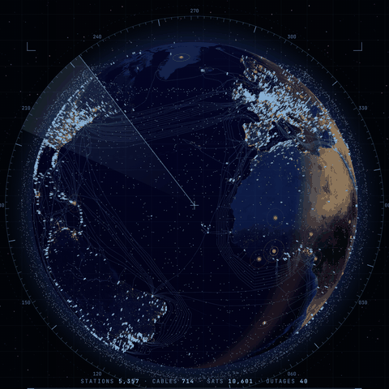
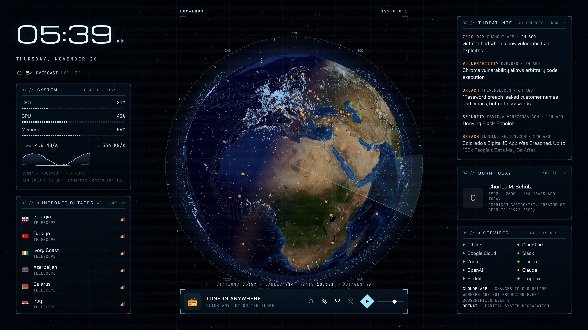
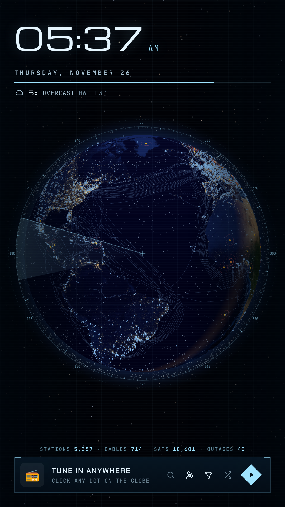

# Deskmate Globe

**A live, interactive desktop wallpaper: a 3D Earth that plays world radio and shows what the internet is doing right now.**

<p align="center"></p>



It's a single HTML file. Run it as your wallpaper with **Plash** (macOS) or **Lively Wallpaper** (Windows), or just open it in a browser.

## Features

- **🌍 Real day and night.** NASA's Blue Marble on the sunlit side, Black Marble city lights on the night side, with the terminator following the real sun.
- **📻 World radio.** Over 5,000 live stations from [Radio Browser](https://www.radio-browser.info) as dots on the globe. Click one to fly there and listen. Search with <kbd>/</kbd>, random with <kbd>R</kbd>, play/pause with <kbd>Space</kbd>.
- **🛰️ Satellites.** The ISS with its orbit track, plus the Starlink fleet. Positions are computed live from orbital elements every 2 seconds.
- **🌐 Undersea internet cables.** About 700 submarine cables. Hover one to see its length, year, landings and owners.
- **🚨 Internet outages.** Countries with connectivity problems in the last 24 h, from [IODA](https://ioda.inetintel.cc.gatech.edu), shown on the globe and in a list.
- **🛡️ Threat intel.** The latest security news, tagged by topic (ransomware, zero-day, breach…). Click to read inside the wallpaper.
- **🚦 Service status.** GitHub, Cloudflare, Google Cloud, Slack, Zoom, Discord, OpenAI, Claude, Reddit and Dropbox.
- **📜 Born today.** One notable historical figure born on today's date, with their Wikipedia introduction.
- **🖥️ PC metrics (Windows + Lively).** CPU, GPU, memory, and network up/down with a live graph.
- **⏰ Clock and weather.** Your timezone, plus optional weather from [Open-Meteo](https://open-meteo.com).
- **💕 Optional "someone far away" mode.** A second person's local time, a glowing arc between your cities, and a days-together counter with 100-day milestones.
- **📱 Vertical reel layout** for phone videos (`#reel`).

<p align="center"></p>

Everything runs from free public APIs: no accounts, no keys, no servers. If you're offline, it keeps showing the last data it had.

## Install

1. Download a ready-made file from the [`download/`](download) folder (open the file, then click the **Download raw file** ↓ button):
   - **Mac:** [`globe-radio-wallpaper.html`](download/globe-radio-wallpaper.html)
   - **Windows:** [`deskmate-lively.zip`](download/deskmate-lively.zip)

   Or build it yourself (see below).
2. Put it somewhere permanent, e.g. `Documents/Wallpaper/`.

**macOS:** install [Plash](https://sindresorhus.com/plash) (free, App Store) → menu bar icon → **Add Website…** → choose the local file. Turn on **Browsing Mode** to click and play radio. Turn off "reload interval" and "mute audio".

**Windows:** install [Lively Wallpaper](https://www.rocksdanister.com/lively/) (free, Microsoft Store). Add **`deskmate-lively.zip`** (not the `.html`). The zip turns on Lively's system information, which feeds the PC metrics panel. In Lively's settings, turn on mouse input and wallpaper audio.

**Desktop icons:** the dashed `LOCALHOST · 127.0.0.1` frame above the globe is a spot for your desktop folders. Drag your icons into it. On Windows, first turn off *View → Auto arrange icons*.

## Configure

Edit **`wallpaper/config.js`**, then rebuild:

```js
window.DESKMATE_CONFIG = {
  home: { timezone: 'auto', lat: 51.51, lng: -0.13, units: 'C' },   // clock + weather ('auto' = this computer's timezone)
  partner: { name: 'Mom', timezone: 'Asia/Tokyo', lat: 35.68, lng: 139.69 },   // or null
  together: { since: '2024-02-14', firstDate: '2023-12-01' },   // or null
  startView: null,   // e.g. { lat: 20, lng: 0 }
};
```

**URL flags** (add them to the end of the file's address):
- `#demo`: fake PC numbers, and hides the partner and together parts. Good for screenshots.
- `#reel`: vertical 9:16 layout for phone videos, also private. It turns on automatically in any portrait window.
- Combine them: `#demo,reel`.

**Keys:**

| Key | Action |
|---|---|
| <kbd>Space</kbd> | Play / pause |
| <kbd>R</kbd> | Random station |
| <kbd>/</kbd> | Search |
| <kbd>C</kbd> | Show / hide cables |
| <kbd>S</kbd> | Show / hide satellites |
| <kbd>Esc</kbd> | Close |

## Build from source

You need Python 3 (with Pillow only for the optional asset scripts).

```bash
python3 scripts/build_wallpaper.py      # → dist/globe-radio-wallpaper.html + dist/deskmate-lively.zip
python3 scripts/fetch_cables.py         # optional: refresh the undersea cable map
```

The build inlines every texture, font and script into one file. Chrome and WebView block WebGL textures loaded from `file://`, so everything has to be in the file itself.

**Tests** (Playwright, all network APIs mocked):

```bash
pip install playwright && playwright install chromium
python3 scripts/build_wallpaper.py && python3 tests/test_wallpaper.py
```

## Notes and limitations

- **Free APIs have rate limits.** If a source is busy, the wallpaper keeps the last data and retries.
- **Satellites:** the full Starlink fleet comes from CelesTrak when it's reachable. Otherwise a few hundred come from a backup source.
- **Lively's system-info fields** are based on its documentation. The PC panel hides itself everywhere else.
- **Radio stations come and go.** If one is offline, press <kbd>R</kbd>.

## Credits & licence

The code is [MIT](LICENSE). Libraries, NASA imagery, flags, country data and the **TeleGeography cable data** keep their own licences, listed in [CREDITS.md](CREDITS.md). The cable data is **CC BY-NC-SA 3.0, non-commercial only**.
